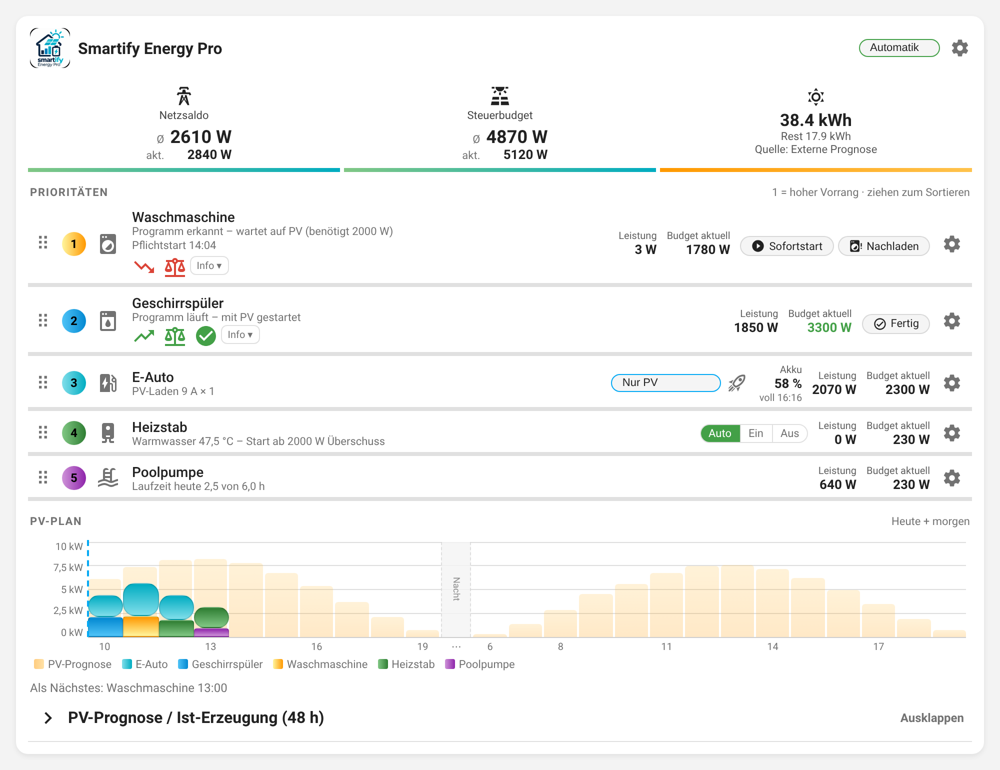
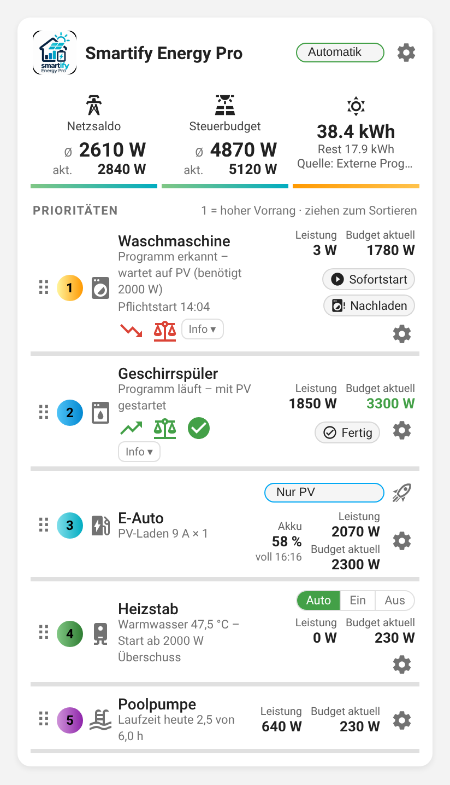
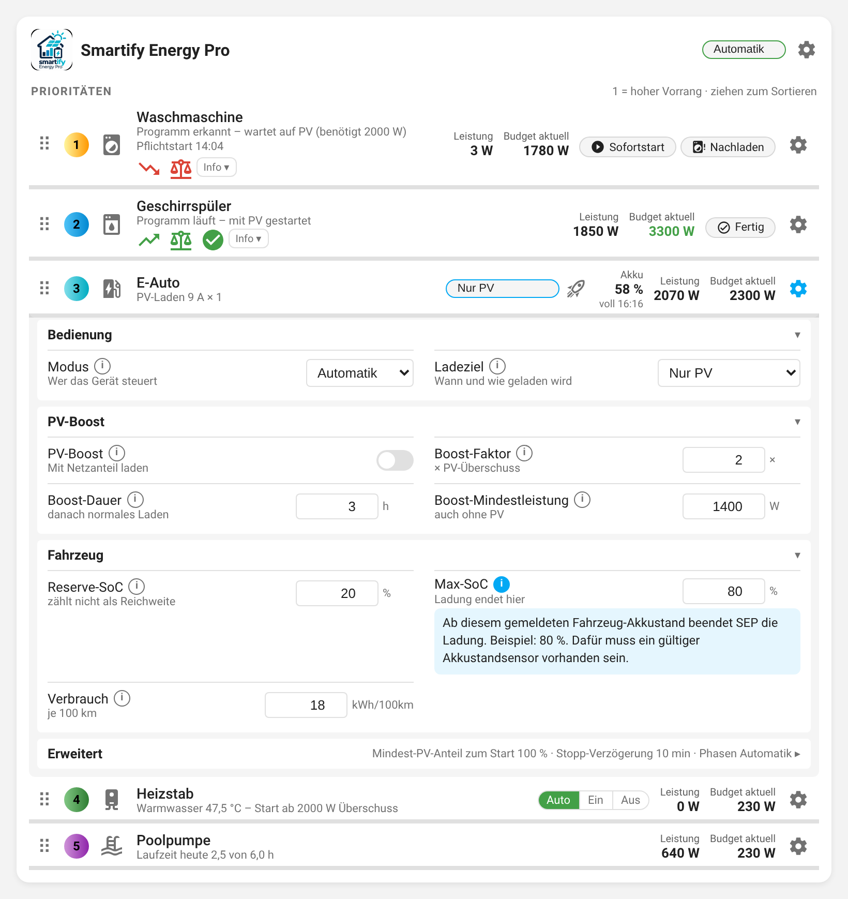
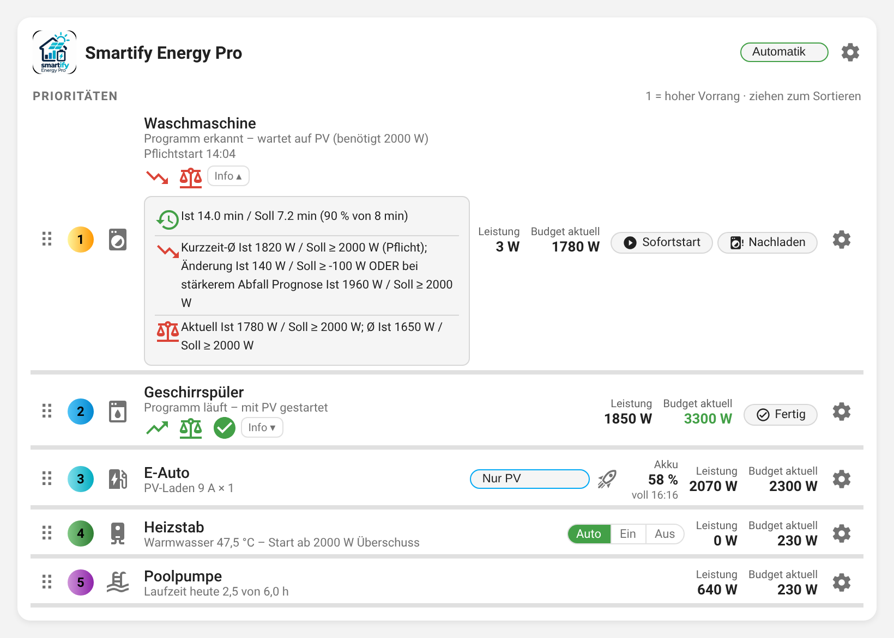

# Smartify Energy Pro

**PV-Überschuss intelligent verteilen – mit Prioritäten, Geräteprogrammen, Batteriespeicher, PV-Prognose und eigener Home-Assistant-Karte.**

Home-Assistant-Integration `smartify_energy` · Oberfläche Deutsch / Englisch · Installation über HACS



> **Versionshinweis:** In HACS erscheint eine neue Version erst, wenn der zugehörige GitHub-Release veröffentlicht und von HACS erkannt wurde. [Veröffentlichte Versionen](https://github.com/smartify-your-home/smartify-energy-pro/releases) · [Alle Änderungen (CHANGELOG)](CHANGELOG.md)

## Inhalt

- [Was macht Smartify Energy Pro?](#was-macht-smartify-energy-pro)
- [Die SEP-Karte](#die-sep-karte)
- [Haushaltsgeräte: Start mit PV](#haushaltsgeräte-start-mit-pv)
- [E-Auto / Wallbox](#e-auto--wallbox)
- [Heizstab, Wärmepumpe, Pool](#heizstab-wärmepumpe-pool)
- [Diagnose: Historie, Trend und Budget](#diagnose-historie-trend-und-budget)
- [PV-Prognose und PV-Plan](#pv-prognose-und-pv-plan)
- [Installation](#installation)
- [Wichtige Hinweise](#wichtige-hinweise)
- [Dokumentation](#dokumentation)

## Was macht Smartify Energy Pro?

SEP verteilt den verfügbaren PV-Überschuss nach einstellbarer Priorität. Berücksichtigt werden der Netzsaldo, bereits laufende und reservierte Verbraucher sowie – je nach Konfiguration – Batteriespeicher und PV-Prognose. Geräte werden in Home Assistant eingerichtet und über die mitgelieferte Lovelace-Karte bedient.

| Gerät / Funktion | Verhalten |
| --- | --- |
| **Waschmaschine, Geschirrspüler** | Programm erkennen, auf PV-Freigabe warten, nach Freigabe ohne Unterbrechung durchlaufen; Spätstart (Pflichtstart), Sofortstart und Nachladen |
| **Heizpausen-Reservierung** | Nach der ersten Heizphase wahlweise weniger Leistung für spätere Heizphasen reservieren; pro Gerät einstellbar |
| **Wäschetrockner** | Eigenes Profil; Modelle ohne zuverlässigen Wiederanlauf werden nicht über die Steckdose angehalten |
| **E-Auto / Wallbox** | PV-Laden mit Stromanpassung und 1/3-Phasen-Umschaltung, Ladeziele (Nur PV, km bis Uhrzeit, Tage-Konfigurator, Sofort), zeitlich begrenzter **PV-Boost** mit Netzanteil, Ladeende-Prognose |
| **Heizstab** | PV-abhängige Temperaturregelung mit Hysterese, Start-/Stoppschwellen; Schnellumschalter Auto / Ein / Aus |
| **Wärmepumpe / Warmwasser** | PV-WW-Boost mit optionalen Wetter-, Sonnenwinkel- und Prognosebedingungen, Schutz vor Mehrfachauslösung |
| **Poolpumpe** | Tageslaufzeit nach Wassertemperatur, Vormittagsziel, optionale tägliche Sperrzeit |
| **Abwesenheit (optional)** | Für Heizstab und WW-Boost je ein `binary_sensor`/`input_boolean` (EIN = abwesend) |
| **Batteriespeicher** | Ladezustand und Ladeleistung in der Priorisierung berücksichtigen; keine direkte Speichersteuerung durch SEP |
| **Prioritäten** | Geräte per Drag & Drop ordnen; nachrangige regelbare Verbraucher werden für höher priorisierte Starts zurückgenommen |

## Die SEP-Karte

Die Integration bringt die Karte mit und registriert sie selbst als Lovelace-Ressource – kein manueller Ressourceneintrag nötig.

```yaml
type: custom:smartify-energy-plan-card
```

**Aufbau**

- **Kopf:** Netzsaldo und Steuerbudget (Mittelwert und aktuell), PV-Prognose heute (ganzer Tag: vergangene Stunden aus der ursprünglichen Prognose, ab jetzt aus der aktuellen) mit Restertrag, Modus des Energiemanagers. Die Kachel „Verteilt“ ist optional (`show_allocated: true`).
- **Prioritätenliste:** je Gerät Status, Leistung und aktuelles Budget an seiner Prioritätsposition. Rechts stehen nur die Bedienelemente, die im aktuellen Zustand wirken:
  - Haushaltsgeräte: **Sofortstart**, **Nachladen**, **Fertig** (setzt die Programmerkennung zurück)
  - E-Auto: **Ladeziel**-Auswahl und Rakete für den **PV-Boost**, Akkustand mit „voll HH:MM“
  - Heizstab: **Auto | Ein | Aus**
  - Ist ein Gerät auf Manuell oder Aus, erscheint der Modus als kleiner Hinweis.
- **PV-Plan:** prognostizierte PV-Leistung und geplante Geräte für heute und morgen, darunter aufklappbar der Vergleich Prognose / Ist-Erzeugung der letzten 48 Stunden.

<p align="center"></p>

Auf schmalen Karten (Smartphone) bleiben Werte und Bedienelemente rechts, lange Statustexte brechen links um.

### Einstellungen (Zahnrad)

Jedes Gerät und der Energiemanager haben ein Zahnrad mit allen Einstellungen – kompakt in thematischen Gruppen (Bedienung, Ladeziel, PV-Boost, Fahrzeug, Temperatur, Laufzeit, Leistung & PV, Zeiten, Speicher). Selten benötigte Gruppen (Programm- & Fertigerkennung, Wetterfilter, Erweitert) sind zugeklappt und zeigen ihre Werte als Zusammenfassung. Jede Einstellung hat eine Kurzinfo; die ausführliche Erklärung öffnet **(i)**. Einstellungen ohne Wirkung im aktuellen Zustand werden ausgeblendet (z. B. Abfahrtszeit und Ziel-Kilometer nur beim Ladeziel „km bis Uhrzeit“).



### Kartenoptionen

| Option | Standard | Wirkung |
| --- | --- | --- |
| `title` | – | Kartentitel |
| `hub` | – | Geräte-ID des Energiemanagers (nur bei mehreren nötig) |
| `show_header` | `true` | Netzsaldo-, Budget- und Prognosekacheln |
| `show_allocated` | `false` | Kachel „Verteilt“ (vom Steuerbudget zugeteilte Leistung) |
| `show_priorities` | `true` | Prioritätenliste |
| `show_mode` | `true` | Ladeziel-Auswahl in der Auto-Zeile |
| `show_settings` | `true` | Zahnrad je Gerät und Energiemanager |
| `show_timeline` | `true` | PV-Plan |
| `timeline_hours` | `24` | Länge des PV-Plans |
| `background_transparency` | `0` | Hintergrundtransparenz 0–100 % (Schrift und Bedienelemente bleiben deckend) |

Alle Optionen sind auch im grafischen Karteneditor einstellbar.

## Haushaltsgeräte: Start mit PV

1. Steckdose und Leistungssensor werden dem Gerät in SEP zugeordnet.
2. Das Programm wird **am Gerät** gestartet; SEP erkennt es an der Leistungsaufnahme (Standard: über 9 W für 20 s; einstellbar).
3. Reicht der Überschuss noch nicht, wartet das Programm vor der Freigabe – **nur bei Geräten, die nach Stromunterbrechung zuverlässig fortsetzen**.
4. Für den regulären PV-Start prüft SEP Historie, Kurzzeittrend und Budget (siehe [Diagnose](#diagnose-historie-trend-und-budget)). Prioritäten und Reservierungen werden berücksichtigt.
5. Nach der Freigabe läuft das Programm durch, auch wenn der Überschuss später fehlt.
6. Ist die **späteste Startzeit** erreicht, gibt SEP das Programm auch ohne PV frei (Pflichtstart, Anzeige „Pflichtstart HH:MM“). Eine bereits eingeschaltete Steckdose bleibt dabei eingeschaltet.
7. Unterschreitet die Leistung die Fertig-Schwelle lange genug (Standard: unter 5 W für 2 min), gilt das Programm als beendet.

**Startschwelle:** mindestens der höhere Wert aus **Nennleistung** und **Mindestüberschuss**.

**Heizpausen-Reservierung:** Nach der ersten abgeschlossenen Heizphase kann ein Teil der Nennleistung für spätere Heizphasen freigegeben werden (**Budgetfreigabe nach Heizphase**, 0 % = volle Reservierung). Der gemessene Verbrauch zählt immer; bei fehlendem Leistungssensor wird die volle Nennleistung reserviert. Mehr Freigabe lässt nachrangige Geräte früher starten, kann aber zu gleichzeitigem Heizen und Netzbezug führen.

## E-Auto / Wallbox

- **Nur PV:** Ladestrom folgt dem Überschuss. Start, wenn aktuelles Budget **und** 2-Minuten-Mittel die Startschwelle erreichen (Mindestladeleistung × Mindest-PV-Anteil). Fehlt Überschuss, wird der Strom sofort reduziert und erst nach der **Stopp-Verzögerung** abgeschaltet – die Karte zeigt dann „PV-Stopp HH:MM“.
- **km bis Uhrzeit / Tage-Konfigurator:** Für die geplante Strecke lädt SEP zuerst mit PV und rechtzeitig vor der Abfahrt mit Netzstrom (Pflichtladung).
- **Sofort:** maximaler Ladestrom, Netzbezug möglich.
- **PV-Boost** (Rakete): für eine einstellbare Dauer (Standard 3 h) mit Boost-Faktor × PV-Überschuss laden, mindestens mit der Boost-Mindestleistung; Netzbezug ist erlaubt. Liegt das Ziel unter dem Wallbox-Minimum (z. B. 6 A × 3), lädt der Boost mit diesem Minimum. Endet nach Ablauf, beim Ausschalten oder Abstecken; Anzeige „Boost bis HH:MM“.
- **Ladeende:** „voll HH:MM“ schätzt, wann Max-SoC bei gleichbleibender Ladeleistung erreicht ist.
- **Startprüfung:** Wartet das Auto auf Überschuss, zeigt die Karte Historie und Budget samt Ist-/Sollwerten unter „Info“. Eine Trendprüfung gibt es beim Auto nicht, weil die Ladung jederzeit angepasst oder gestoppt werden kann.

## Heizstab, Wärmepumpe, Pool

- **Heizstab Auto:** heizt nur mit Überschuss zwischen Start- und Stoppschwelle bis zur Maximaltemperatur. Ohne gültigen Netzsensor-Wert wird er abgeschaltet und nicht neu gestartet („Netzsensor ungültig“). Laufende Heizstäbe werden vor allen anderen Geräten geprüft, damit sie unterhalb der Abschaltschwelle zuverlässig ausgehen.
- **Heizstab Ein** (= Modus Manuell): heizt temperaturgeregelt bis zur Maximaltemperatur, auch mit Netzstrom; Temperaturschutz und Mindestpause bleiben aktiv. **Aus** schaltet sofort ab.
- **Wärmepumpe:** PV-WW-Boost mit optionalem Sonnenfilter, Bewölkungs- oder PV-Prognose-Startbedingung. Bei Abwesenheit wird ein Number-WW-Boost zurückgenommen und kein neuer Einmal-WW-Start ausgelöst; WP-eigene WW-Zyklen bleiben unberührt.
- **Poolpumpe:** Tageslaufzeit fix oder nach Wassertemperatur, Anteil bis zum Vormittagsziel (notfalls mit Netzstrom), optionale tägliche Sperrzeit (z. B. Mittagsruhe).

## Diagnose: Historie, Trend und Budget

Haushaltsgeräte und Wärmepumpe zeigen drei Startprüfungen als farbige Symbole, das E-Auto Historie und Budget. **Info ▾** öffnet die Ist- und Sollwerte.



| Symbol | Bedeutung |
| --- | --- |
| **Historie** | Genügend Messdaten für das Langzeitmittel (90 % des Mittelungsfensters). Wird ausgeblendet, sobald erfüllt. |
| **Trend** | Der Kurzzeit-Mittelwert erreicht die Startleistung; bei stärker fallendem Trend muss auch die Fortschreibung reichen. |
| **Budget** | Aktuelles **und** gemitteltes Gerätebudget decken die Startleistung. |

Der grüne Haken erscheint nur, wenn alle Bedingungen erfüllt sind. Sofortstart, Sofortfenster und Pflichtstart haben eigene Regeln. Die Trendbewertung ist keine Wetterprognose.

## PV-Prognose und PV-Plan

Unter **Einstellungen → Geräte & Dienste → Smartify Energy Pro → Konfigurieren → Prognose**:

- **Externe Prognose (Standard):** eine Prognose-Integration der Home-Assistant-Energieplattform (z. B. Forecast.Solar, Solcast, Open-Meteo Solar Forecast) oder ein Prognosesensor.
- **Eigene Berechnung (My-Weather):** Standort aus Home Assistant und Bewölkung aus `Meteonomiqs Cloud Forecast 48h` (Attribut `forecast` mit `cloud_coverage` 0–100 %; der bisherige 8-h-Sensor funktioniert weiterhin, liefert aber nur 8 h). Die **PV-Flächen** werden seit 0.3.64 nicht mehr in diesem Dialog eingetragen, sondern im Dashboard eingezeichnet (siehe „PV-Flächen einzeichnen“). Flächen nicht doppelt erfassen. Für Stunden ohne Bewölkungswerte werden keine sonnigen Stunden ergänzt. SEP macht keinen eigenen Meteonomiqs-API-Aufruf.

Die Prognose speist PV-Plan und Planungswerte; Netzsaldo und Start-/Stoppschutz bleiben messwertbasiert. Bei Nebel und Hochnebel sind Prognosen besonders unsicher.

**Automatische Kalibrierung (optional, nur bei eigener Berechnung):** **PV-Prognose automatisch kalibrieren** aktivieren und den **PV-Erzeugungsleistungssensor (W)** wählen – er muss die gesamte Erzeugung aller konfigurierten Flächen abbilden (nicht Netzsaldo, Hausverbrauch oder Akku). Gelernt wird höchstens alle zehn Minuten bei mindestens 300 W Prognose, getrennt für klar / teilweise / bedeckt. Nächte, ungültige Messungen und wahrscheinliche Wechselrichter-Begrenzung werden ignoriert. Vor sechs Messungen bleibt der Faktor 1,0; Änderungen sind gedämpft und auf 0,60–1,25 begrenzt, Lernhistorie maximal 30 Tage (übersteht Neustarts). Das Attribut `kalibrierung` der Prognose-Entität zeigt Faktoren, Stichproben und mittlere Fehler (7/30 Tage); **PV-Kalibrierung zurücksetzen** löscht nur diese Lerndaten. Bei Abregelung, Defekten oder Verschattung die Kalibrierung deaktivieren.

**PV-Plan:** kW-Achse mit Hilfslinien; prognostizierte PV-Leistung und geplante Geräte je Stunde. Der aufklappbare Bereich **PV-Prognose / Ist-Erzeugung** zeigt die letzten 48 Stunden (horizontal scrollbar, kWh je Stunde, prozentuale Abweichung). Verglichen werden nur Stunden mit mindestens 95 % gemessener Leistung und einer vorher gespeicherten Prognose; Messlücken erscheinen nicht als Nullertrag. Dafür den PV-Erzeugungsleistungssensor im Prognose-Dialog auswählen.

### PV-Flächen einzeichnen (ab 0.3.64)

Karte **SEP PV-Flächen** zu einem Dashboard hinzufügen:

```yaml
type: custom:smartify-energy-pv-card
title: PV-Flächen          # optional
# entry_id: …              # nur bei mehreren Energiemanagern
```

- **Luftbild:** Orthofoto von [basemap.at](https://basemap.at) (nur Österreich, CC BY 4.0) rund um den Home-Assistant-Standort. Es wird **nur beim ersten Öffnen** heruntergeladen und in Home Assistant gespeichert (`.storage/smartify_energy_map/`, ist damit Teil der Sicherung). Neu geladen wird es nur über **„Luftbild neu laden“** – dann für den aktuellen Kartenmittelpunkt. Ohne Luftbild (z. B. außerhalb Österreichs) kann auf einem Raster gezeichnet werden.
- **Dachfläche:** „+ Dachfläche“, die Ecken antippen, Doppelklick oder „Fertig“. Die dick markierte Kante ist die **Traufkante** (untere Dachkante); antippen einer anderen Kante der markierten Fläche ändert sie. Die **Ausrichtung** ergibt sich automatisch (Seite, zu der das Dach abfällt) und wird als Pfeil angezeigt.
- **Fassade/Linie:** „+ Fassade/Linie“, Anfang und Ende antippen; mit „Richtung umdrehen“ die Seite wählen.
- **Neigung** (0° flach – 90° senkrecht) je Fläche eingeben. **Leistung** wahlweise als **kWp gesamt** oder **Module × Wp**.
- Ecken lassen sich verschieben, die Karte mit Ziehen, Mausrad oder +/− bewegen. **Speichern** übernimmt die Flächen; der Energiemanager lädt neu und rechnet die Prognose damit.
- Höchstens vier Flächen. Bisher eingetragene Werte werden als „nicht eingezeichnet“ übernommen (Ausrichtung dort weiterhin als Zahl änderbar) und können eingezeichnet werden. Nur Administratoren können ändern.
- Die Flächen werden nur bei Prognose-Modus **Eigene Berechnung** verwendet.

### PV-Prognose gegen Ist-Erzeugung (14 Tage)

Unter dem PV-Plan öffnet die Vergleichsgrafik die letzten 14 Tage. Prognose und Ist-Erzeugung erscheinen je Stunde als Balkenpaar mit prozentualer Abweichung. Tagesüberschriften und senkrechte Trennlinien ordnen die Stunden; bei jeder Tagesüberschrift steht die Abweichung des Tages (bei Messlücken als „bisher“). Nachtstunden werden mithilfe der von Home Assistant berechneten Sonnenaufgangs- und Sonnenuntergangszeiten ausgeblendet; auf beiden Seiten bleibt eine Stunde sichtbar. Die Stundenprognose wird vor dem jeweiligen Zeitraum eingefroren, damit spätere Wetterupdates den Vergleich nicht verfälschen. Für Stunden mit fehlenden Messdaten zeigt SEP keine erfundene Ist-Energie an. Die Historie baut sich nach dem Update schrittweise auf.

## Installation

1. **HACS → Benutzerdefinierte Repositories** öffnen.
2. `https://github.com/smartify-your-home/smartify-energy-pro` als Kategorie **Integration** hinzufügen.
3. **Smartify Energy Pro** installieren bzw. aktualisieren.
4. **Home Assistant neu starten** (nötig bei jeder Änderung am Python-Code; reine Karten-Updates brauchen nur ein Neuladen des Browsers).
5. **Einstellungen → Geräte & Dienste → Integration hinzufügen → Smartify Energy Pro**, danach Geräte und benötigte Entitäten hinzufügen ([Benötigte Felder](docs/REQUIRED_FIELDS.md)).
6. Karte ins Dashboard einfügen und die Seite neu laden. Zeigt die Companion-App eine veraltete oder keine Karte, dort den Frontend-Cache zurücksetzen.

## Wichtige Hinweise

- **Nicht wiederanlauffähige Geräte** dürfen nicht über eine Steckdose angehalten werden – beim Trockner das passende Profil wählen.
- **Hauptschalter Aus** ist kein elektrischer Not-Aus. Haushaltsgeräte-Steckdosen werden zur manuellen Bedienung freigegeben; Pool und Wallbox stoppen nur bei ihrem eigenen Modus Aus.
- **Heizstab Ein/Manuell, Pflichtstart, Pflichtladung, Sofort und PV-Boost** können Netzstrom verwenden. Temperaturbegrenzung und elektrische Absicherung bleiben erforderlich.
- **Messsensoren und Prioritäten** müssen korrekt eingerichtet sein. Ein plausibler, aber eingefrorener Messwert wird nicht erkannt.
- **Reaktionszeit:** Netz-, Akku- und Geräteleistungen werden nach 0,25 s Bündelung neu bewertet; Moduswechsel und manuelle Aktionen ohne Wartezeit. Hysterese, Schutzzeiten und Startprüfungen bleiben wirksam.
- Nach Updates die [Release Notes](CHANGELOG.md) prüfen.

## Dokumentation

- [Alle Versionen und Release Notes](CHANGELOG.md)
- [Aktueller Funktionsstand und technische Grenzen](docs/FUNCTIONS.md)
- [SEP-Funktionen im Detail](docs/SEP_CURRENT.md)
- [Update-Anleitung und Funktionstest](docs/UPDATE.md)
- [Benötigte und optionale Entitäten](docs/REQUIRED_FIELDS.md)
- [Migration von SEM v3](docs/SEM_ENTITY_MIGRATION.md)
- [Fehler melden oder Funktionen vorschlagen](https://github.com/smartify-your-home/smartify-energy-pro/issues)

Die Bilder in dieser README zeigen die echte Karte mit Beispieldaten; neu erzeugen mit `npm i --no-save @mdi/js@7.4.47 @fontsource/roboto@5.1.0 && node scripts/readme_images.cjs . docs/images`.
